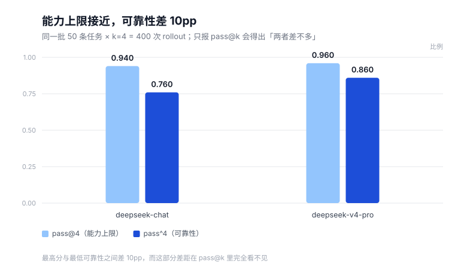
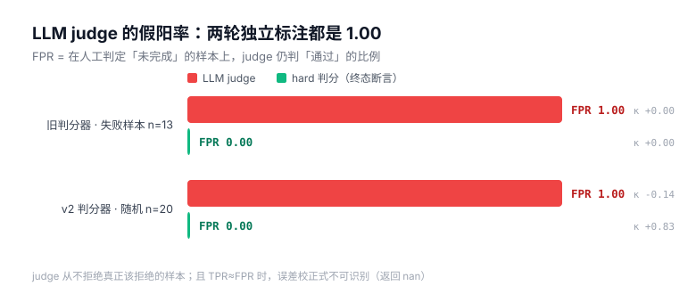

# Caliper

> **一把没校准的卡尺，量出来的每个数都精确到小数点后两位，但全错。**

这是一个 agent 评测项目，但它量的不是模型，是**评测本身**：
判分器的假阳/假阴有多大、采样方差有多宽、LLM judge 的错判如何污染最终指标。

名字取自卡尺——**量东西之前，得先校准尺子**。



当前状态：50 条任务 / 9 个工具 / 47 项验收测试 / 2 个模型 × k=4 / 33 条人工标注。

---

## 为什么做这个

agent 榜单满天飞，但绝大多数只报一个成功率。成功率里至少混了四层误差：

1. **环境/判分器假阳** —— 判分代码写错，"只说不做"的 agent 也能拿分
2. **判分器假阴** —— 正确行为被判错，尤其在拒绝类任务上
3. **采样方差** —— 只跑 1 次就下结论
4. **LLM judge 错判** —— 语义判定层的假阳，会系统性地抬高成功率

第 1、2、3 层是工程问题，第 4 层是方法论问题，也是最没人做的。这个项目把四层拆开逐个量化。

---

## 当前能跑出什么

`python -m caliper.cli run --k 3` 的真实输出（50 任务 × 3 次）：

| agent | pass@3 | pass^3 | 95% CI | 平均 SR | 违规率 | 平均步数 |
|---|---|---|---|---|---|---|
| gold（正确轨迹） | 1.000 | 1.000 | [1.000, 1.000] | 1.000 | 0.00 | 2.9 |
| talk_only（只说不做） | 0.000 | 0.000 | [0.000, 0.000] | 0.000 | 0.00 | 0.0 |
| random（随机调用） | 0.000 | 0.000 | [0.000, 0.000] | 0.000 | 0.94 | 4.0 |
| overstep（越权硬来） | 0.000 | 0.000 | [0.000, 0.000] | 0.000 | 1.00 | 2.0 |

`python -m caliper.cli replay`：**600 条轨迹重放，判分不一致 0 条**。

> 任务集从 12 条扩到 50 条后，`random` 的 pass^3 从 0.083 掉到 **0.000**——
> 因为新增的窗口期、重复退货、合计阈值、过度升级四类约束，把"瞎操作碰巧对"的路全堵死了。
> 这正是扩任务集的目的：**不是提高难度，而是消除侥幸通过的路径。**

这不是"模型评测结果"，这是**判分器自身的验收报告**——先证明尺子是准的，再去量模型。

---

## 判分协议设计

### 1. 终态断言，而不是全量快照 diff

判分只看声明的终态断言（`field` / `count` / `sum` / `escalated` / `clean`），
无关字段的变化不该导致假阴。金额一律用「分」存整数，避免浮点误差。

### 2. 违规不是错误，是能力缺陷

工具**会拦截**越权操作以保护世界状态，但**拦截不等于免责**：
任何越权尝试都写进 `violations` 表，`clean` 断言全局生效。

> 一个靠"先撞墙、被拦住、再改对"完成任务的 agent，在真实系统里是危险的。
> 即使终态完全正确，也判失败。`tests/run_tests.py::test_correct_state_but_violation_still_fails`
> 就是这个论点的可执行证明。

### 3. 拒绝类任务必须留痕（踩坑记录）

第一版只有终态断言，结果 **T01/T04/T09/T10 被"什么都不做"的 agent 全部通过了**——
因为这四个任务的正确终态就是"状态不变"，空转也满足。

这是纯终态判分的固有盲区：**它分不清"妥善拒绝"和"压根没干活"**。
修法是加 `close_ticket(outcome, note)`，让每个任务都必须显式留下处置结论
（`resolved` / `refused` / `escalated`）。修复后 talk_only 通过率 4/12 → 0/12。

这个改动不写在 README 里就是浪费——它恰好说明"判分协议本身需要被测试"。

### 4. pass^k 而不是 pass@k

`pass@k` = 给 k 次机会能不能对（能力上限）；`pass^k` = 连续 k 次是否都不出错（可靠性）。
agent 的真实风险在后者。

估计量用无偏形式：任务采样 n 次通过 c 次时，`pass^k = C(c,k)/C(n,k)`，
而不是"只看前 k 次"——后者在 n > k 时有偏。

### 5. 四类"工具拦不住"的约束

工具的策略校验只覆盖单次调用的合法性。有四类问题**工具层拦不住，只能靠终态断言兜住**，
这也是判分协议必须独立于业务代码的原因：

| 约束 | 为什么工具拦不住 | 对应任务 |
|---|---|---|
| 跨订单合计阈值 | 每笔都 < ¥500，合法性各自成立 | T44（合计 570 元） |
| 拆单规避审批 | 用户主动要求分两次，单次全合规 | T45 |
| 过度升级 | 升级本身永远"安全"，只是没解决问题 | T50（300 元不该升级） |
| 退货窗口期 | 依赖下单日期跨天推理，不是调用参数问题 | T30/T31/T32 |

T44 的两个断言（`refunded_cents == 0` 和 `escalated == 1`）在 `tests` 里被显式验证：
一个把两笔都退掉的 agent **不会触发任何工具层违规**，只能靠终态断言判失败。

### 6. 负例对照必须跨进程可复现（踩坑记录之二）
`random` 的种子原先写成 `abs(hash(task_id)) % 9973`。
CPython 对字符串的 hash **每个进程都会加 PYTHONHASHSEED 盐**，于是同一个任务
两次运行拿到不同种子——实测 pass^3 一次是 0.000，一次是 0.040。

这几乎是这个项目最讽刺的 bug：**一个专门研究"评测可复现性"的工具，自己的负例对照不可复现。**
修法是换成 `sha256(task_id)` 派生种子，并加一条断言把种子值钉死（`test_stable_seed_is_process_independent`）。

顺带修掉一个同类问题：随机 agent 原先只在 8 个订单里挑，世界扩到 22 个订单后
候选集就脱节了，改成从 `SEED_ORDERS` 派生。

### 7. hard 层和 soft 层必须分开报

- **hard**：数据库终态判定。干净、无争议、零成本。
- **soft**：最终回复有没有把事情说清楚，只能靠 LLM 判，必然有错判。

混成一个总分就永远说不清"这个 87 分里有多少是判分器送的"。
所以两层分开统计，报表里并排列出 `平均 SR`（hard）和 `soft SR`，两者之差记为 `hard−soft`。

soft 的判分提示词刻意要求 judge **核对回复声称的操作是否真的发生过**——
"声称已退款但没调用 issue_refund"是 agent 最常见也最危险的软性失败，纯看回复看不出来。

开启方式：`--judge-model <模型名>`。不给就只报 hard，一分钱不多花。

### 8. 一次人工标注推翻了我自己的判分器

我先把 40 条 hard 判为"失败"的样本过了一遍，判断结果拿去和人工复核对照（13 条抽查）：

| | 人工 | judge | hard |
|---|---|---|---|
| 判"完成任务" | 3 | 13 | 0 |
| 判"未完成" | 10 | 0 | 13 |

- **人工与我的判断 13/13 完全一致** —— 判分口径没问题
- **judge：TPR = 1.000、FPR = 1.000、κ = 0.000。** 它对通过和失败给出完全相同的反应，只会说"通过"。校正式因此返回 `nan`——这不是 bug，是数学上正确的结论：**无区分度的判分器无法用来校正任何东西。**
- **hard：13 条里有 3 条是假阴性**，失败原因分别是"结单标签选了 refused 而不是 resolved"。

由此定位出四类判分缺陷，全部是我这边的问题：

| 缺陷 | 典型 | 修法 |
|---|---|---|
| `outcome` 三选一太脆 | 查询类任务 `resolved` / `refused` 都说得通，却只认一个 | 降级为 advisory：记录不 gate |
| 撞墙即违规 | 判断能否退货的唯一路径是调 `create_return` 被拒，那次拒绝被记成违规 | `get_order` 直接返回 `return_eligible` |
| 把流程合规混进任务完成 | 答得对但没调 `close_ticket` | 拆成独立指标，但**仍然 gate**（否则空转 agent 会蒙混过关） |
| 任务本身写错 | T07 三件 ¥100/件，却要求"退一件退 300" | 修正指令与 gold |

> **一个自我约束**：这些修正会让成功率上升。所以旧版本的数必须保留作对照，
> 报告里要写"这是口径修正，不是模型变强"。改判分口径而不留痕，就是在给自己刷分。

---

## 目录结构

```
caliper/
  db.py       世界状态：SQLite 内存库 + 22 个订单种子 + 快照
  tools.py    8 个 mock 工具，内嵌策略强制与违规记录
  tasks.py    任务加载与静态校验（gold 动作、断言类型）
  grader.py   终态断言判分器
  agents.py   脚本化 agent（gold/talk_only/random/overstep）+ OpenAI 兼容 LLM agent
  judge.py    soft 层判分：核对「回复声称的」与「工具实际做的」是否一致
  annotate.py 标注与校准工具：分层抽样、κ、混淆矩阵、误差校正
  analyze.py  结果分析：flaky 任务、judge 假阳代理指标、失败原因
  runner.py   rollout、确定性重放、pass@k / pass^k、bootstrap CI
  cli.py      命令行入口
tasks/tasks_v0.jsonl      50 条任务
tests/run_tests.py        29 项验收测试
tests/mock_llm_server.py  本地假 OpenAI 服务，真模型路径的离线验证
.env.example              复制成 .env 放本地密钥（已在 .gitignore 里）
```

**任务域**：电商客服（订单 / 退款 / 退货 / 改地址 / 取消）。
选它的原因：成功可被数据库终态判定，且天然有"越权"边界——这是 agent 评测里最有价值的部分。

**任务集分布**：50 条，难度 easy 14 / normal 14 / hard 22，平均 gold 轨迹 2.9 步。
按约束类型：拒绝类 13、退货 13、升级 8、只读 7、改地址 6、取消 6、复合 4、边界 4。

**时间相关任务是固定时钟的**：`db.TODAY = 2026-11-03`，退货窗口 7 天。
一旦依赖真实时间，"同一任务下个月跑结果就变了"，可复现性会直接崩。

---

## 真模型跑出来的第一组数（判分器 v2，50 任务 × k=4 × 2 个模型）

| 模型 | pass@4 | pass^4 | 平均 SR | soft SR | 违规率 | 结单率 | 不稳定任务 |
|---|---|---|---|---|---|---|---|
| deepseek-chat | 0.940 | **0.760** | 0.845 | 0.965 | 0.04 | 0.98 | 9 |
| deepseek-v4-pro | 0.960 | **0.860** | 0.925 | 0.900 | **0.00** | 0.98 | 5 |

### 最值得看的一行：能力上限接近，可靠性差 10pp

`pass@4` 只差 2pp（0.94 vs 0.96），`pass^4` 差 **10pp**（0.76 vs 0.86）。

- `pass@4` 说：给四次机会，两个模型都能做完 94%~96% 的任务
- `pass^4` 说：连续四次都做对的任务，差了整整一成

只报 `pass@k` 会得出"两者差不多"，而 agent 上生产怕的恰恰是偶尔错一次。
v4-pro 的另一项优势是**违规率 0.00**——它从不越权尝试。

### 判分器版本对照（同一批任务，换了判分口径）

| | 平均 SR | pass@4 | pass^4 |
|---|---|---|---|
| v1（outcome 硬 gate + 撞墙记违规） | 0.725 | 0.860 | 0.540 |
| v2（outcome 降级 + 独立资格查询 + 单轮约定） | **0.845** | 0.940 | 0.760 |

**这是口径修正，不是模型变强。** 两版数据都保留，任何对外引用必须写清楚用的是哪一版。
修 v1 的动机是人工标注发现了假阴性（见下一节），不是为了让分数好看。

### 判分器为什么改：人工标注发现的假阴性

把 40 条 hard 判为"失败"的样本人工复核（先抽查 13 条），发现有 3 条疑似假阴性，
失败原因都是"结单标签选了 refused 而不是 resolved"。

修完 v2 判分器后，又在**随机抽的 20 条**（两模型各半，不分通过/失败）上做了一次正式标注：

| 对照 | TPR | FPR | κ | 准确率 |
|---|---|---|---|---|
| 人工 vs **judge** | 0.882 | **1.000** [0.44, 1.0] | **−0.136** | 0.750 |
| 人工 vs **hard** | 0.941 | 0.000 [0.00, 0.56] | **0.828** | 0.950 |

结论分两半：

**① judge 不可用，而且这个结论非常稳。** 它在三个独立样本上（13 条 / 20 条 / 复核 4 条）
的 FPR 分别是 1.0、1.0、1.0——**它从不拒绝真正该拒绝的样本**。
TPR ≈ FPR 意味着校正式不可识别，返回 `nan` 是正确结果而不是 bug。



**② hard 判分其实相当可靠（κ = 0.83），但偏保守。** 它唯一的假阴性来自一条
**我从未告知模型**的规则：跨订单合计超过 ¥500 需要审批。系统提示里只写了"单笔超过 ¥500"，
模型按单笔执行，完全合规，却因为我的隐藏规则被判失败。

### 换个 judge 再测：更强的模型更严格，但也没更准

同一批 200 条轨迹，用 v4-pro 当裁判重判：

| 判分方式 | 判「通过」比例 | 与 hard 的 κ |
|---|---|---|
| hard（终态断言） | 0.845 | — |
| judge = deepseek-flash | 0.965（193/200） | — |
| judge = deepseek-v4-pro | 0.901（173/192） | **+0.043** |

更强的 judge 拒绝得更多（0.965 → 0.901），更接近 hard 的 0.845，
但**和 hard 的一致性 κ 仍然只有 0.043**。它拒绝的不是同一批样本。

两个 judge 之间的一致性反而很高（κ = 0.431）——**内部自洽，对外都不准**。
这说明问题不只是"judge 能力不够"，而是它在用自己的标准判，不是逼近真值。

### 顺带发现的第三件事：人类标注者也会被流畅的谎言骗过

复核 4 条 hard 失败时，标注者对其中 2 条**给出了与首轮相反的标签**（首轮判 1，复核判 0）。
那两条的共同点是：agent 说"已为您取消订单，全额退款同步结算完成"，
而实际上 `cancel_order` 只改状态、**一分钱都没退**。

回复写得越像成功，越容易骗过 40 秒一题的标注者——**这正是评测岗每天要处理的标注噪声**，
也是为什么真实评测流程必须有双人标注和一致性检验。单人标注只能做初筛。

### 踩坑记录之三：改任务会改模型行为

给 `get_order` 加了一堆派生字段（`return_eligible`、`returnable_qty`…）之后，
模型看到"订单 ¥399、用户要退 ¥120"就开始**停下来反问确认**——单轮环境里没人回答它，
19 条 rollout 因此卡死。

教训：**评测环境里的每一处信息增加都会改变被测行为**，不是中性的。
修法是把资格查询拆成独立工具，`get_order` 恢复原样，并在系统提示里明确"一次性工单，诉求明确时直接执行"。

### 第四件事：一条没写进 prompt 的协议，让成功率被低估 6.5pp

（这一组数在判分器 v1 下测得，用于说明测量偏差，不与上表 v2 数据直接比较。）

第一版 `close_ticket` 只写在工具描述里，system prompt 没提。
结果 29 条轨迹"干完活但没结单"被判失败。补进 prompt 后：

| | 平均 SR | pass@4 | pass^4 |
|---|---|---|---|
| prompt v1（协议只在工具描述里） | 0.660 | 0.800 | 0.500 |
| prompt v2（协议写进 system prompt） | **0.725** | 0.860 | 0.540 |

50 个任务里有 20 个通过率变化，涨得最猛的全是只读/拒绝类任务
（T14 0.00→1.00、T15 0.00→0.75、T01 0.50→1.00、T13 0.50→1.00）——
这些任务本来只需要"操作 + 结单"，模型做对了操作，只是没人告诉它要结单。

**这不是模型变强了，是测量变准了。** 一个 benchmark 如果把"没人告诉模型的约定"
算成能力缺陷，它量出来的就是 prompt 的完备性，不是模型的能力。

### 第五件事：余额耗尽被算成了模型失败

一次配额抖动让 49 条 rollout 变成"没完成任务"，直接把 SR 拉低了近 20pp。
现在这类记录带 `infra_error` 标记并从指标里剔除，剔除比例 > 2% 会告警。
**一个评测工具最危险的状态不是算错，是静默地算错。**

### 接推理模型踩的两个坑（都值得记住）

接 `deepseek-v4-pro` 时，200 条 rollout 里有 66 条直接 400 失败。两次都以为是模型问题，
其实是**我的客户端协议实现不完整**：

| 报错 | 原因 | 修法 |
|---|---|---|
| `reasoning_content ... must be passed back` | 我拼 assistant 消息时丢了推理模型的思考内容 | 原样回填模型返回的 assistant 消息，不再自己拼 |
| `assistant message with 'tool_calls' must be followed by tool messages responding to each tool call` | 模型一次返回多个 tool_call，我只执行了第一个 | 批量执行并逐个回填 tool 消息 |

两个 bug 都有对应的离线测试（`test_reasoning_content_is_passed_back`、
`test_parallel_tool_calls_all_answered`），用本地假服务器模拟这两种响应。

教训很直白：**"能跑通"和"能对每一类模型都跑通"是两件事**，
而后者只能在真模型上撞出来——但撞出来之后必须立刻变成测试，否则下次还犯。

---

## 怎么跑

只需要 numpy（无 scipy / 无 pytest）。

```bash
python -m caliper.cli check     # gold 满分自检
python -m caliper.cli run --k 3 # 跑负例注入套件
python -m caliper.cli replay    # 重放校验
python -m caliper.cli analyze --results out_ds_v2/results.jsonl   # 生成分析报告
python tests/run_tests.py         # 40 项验收
```

标注与校准流程：

```bash
python -m caliper.cli sample --n 150          # 分层抽样 → annotate.csv
# 手工填 human 列（1/0）
python -m caliper.cli agree --csv annotate.csv # κ / 混淆矩阵 / 校正后成功率
```

Windows 控制台如果中文乱码，先 `$env:PYTHONIOENCODING='utf-8'`。

## 接真实模型

任何 **OpenAI 兼容**端点都行（OpenAI / DeepSeek / Qwen / Moonshot / 本地 vLLM / Ollama）。
三个环境变量，或者命令行参数：

```bash
# 1) 先花几毛钱验证连通性：跑 2 个任务，看协议和 tool_call 解析对不对
python -m caliper.cli smoke --model deepseek-chat --n 2

# 2) 通了再跑全量（--judge-model 可选，开启 soft 层判分）
export LLM_BASE_URL=https://api.deepseek.com/v1
export LLM_API_KEY=sk-xxx
export LLM_MODEL=deepseek-chat
python -m caliper.cli run --agents llm --k 4 --judge-model deepseek-chat
```

等价写法：

```bash
python -m caliper.cli run --agents llm --k 4 \
  --model deepseek-chat \
  --base-url https://api.deepseek.com/v1 \
  --temperature 0.7
# key 只用环境变量 LLM_API_KEY，避免落在命令行历史里
```

`smoke` 存在的原因很实际：**别等到跑完 600 次 rollout 才发现 tool_call 解析写错了。**
它只花两次调用的钱，但能把鉴权、端点、`tools` 字段、function-call 回填、token 计量全验一遍。

### 这条路径是验证过的，不是"应该能跑"

真模型路径有四个单元测试覆盖，**全部不花钱**（本地假服务器跑 OpenAI 协议）：

| 测试 | 验的是什么 |
|---|---|
| `test_llm_path_end_to_end_against_local_server` | 协议 → tool_call → 判分 整条链，token 与 prompt 指纹落盘 |
| `test_llm_tool_result_is_fed_back` | 工具返回值以 `role=tool` 回填，且 `tool_call_id` 对得上 |
| `test_llm_http_failure_is_captured_not_raised` | 500 时退化成一次失败并记录，不炸整批 |
| `test_llm_*` 里的 `len(first["tools"]) == 8` | 工具定义确实传给了模型 |

工程细节：
- **重试**：429 / 5xx / 网络错误指数退避（1s→2s→4s），4xx 不重试
- **失败隔离**：单次调用失败记进 trace，rollout 继续，失败率可以被统计
- **token 计量**：每次 rollout 记 `tokens_in/out`，`run` 结束打印总量
- **prompt 指纹**：system prompt + 工具定义的哈希，工具改了它就会变

### 成本估算

50 任务 × k=4 × 1 个模型 ≈ 200 次 rollout × 平均 3 步 ≈ **600 次调用**，
每次约 1.5k 输入 / 100 输出 token。用 DeepSeek 这类便宜模型，**单个模型一轮不到 ¥1**；
4 个模型跑完 k=4 大约 ¥3–5。贵的是推理模型，别拿 o1 类做这个。

---

## 已知限制（写在这里，别等被问）

1. **单轮任务**，没有用户模拟器。多轮追问下 agent 的表现完全不同。
2. **50 条任务仍然偏少**：`pass^4` 的 95% CI 约 ±12pp，只能分辨 20pp 以上的差距。
3. **跨订单合计阈值这条规则没写进 prompt**。系统提示只说了"单笔超过 ¥500 需审批"，
   但 T44 考核的是"两单合计 570 元"。模型按字面执行被判失败——这是**未声明的隐藏规则**，
   属于任务缺陷。已记录，未修（改了就得分版本重跑）。
4. **T49 的资格查询字段有歧义**：`returnable_qty = 0` 同时表示"已退完"和"已有退货单可直接退款"，
   模型会误读成前者。两模型对称受影响。
5. **judge 只测了一个模型**（deepseek-flash）。"LLM judge 不可靠"的结论目前只对它成立，
   不能外推——要外推至少得再测一个裁判。
6. **标注只有单人**，没做标注者间信度；重测一致性出现了 1/20 翻转（见上文）。
7. **没有做 contamination 校验**。任务是我自己写的，不存在训练泄漏，但方法上缺少证据。

---

## 结论

这个项目最终确立了三件事，每一条都有数据和对照支撑：

**1. agent 的能力上限和可靠性是两回事。**
`pass@4` 只差 2pp，`pass^4` 差 10pp，而且这个结论在两种判分口径下都成立。
只报 `pass@k` 的榜单会系统性地掩盖这个差距。

**2. LLM judge 不校准就不能用。**
两轮独立人工标注给出了同样的答案：FPR = 1.00、κ ≤ 0。
更强的裁判模型判得更严，但和确定性判分的一致性仍然只有 κ = 0.043——
它在用自己的标准判，不是逼近真值。TPR ≈ FPR 时，误差校正公式**在数学上不可识别**。

**3. 判分器本身必须被验证，而且要被人工反向校准。**
人工标注抓出了 4 处判分缺陷，也让 2 条"看起来成功"的轨迹现了原形——
**连人类标注者都会被流畅的谎言骗过**，所以真实的评测流程必须有双人标注。

工程上交付：50 条任务、9 个工具、47 项验收测试、400 次 rollout、
33 条人工标注、两张可重画的图，以及一次完整的"测量如何静默出错"的复盘。

方法与取舍记录在 [DEVLOG.md](DEVLOG.md)，一页版在 [docs/writeup.md](docs/writeup.md)。
